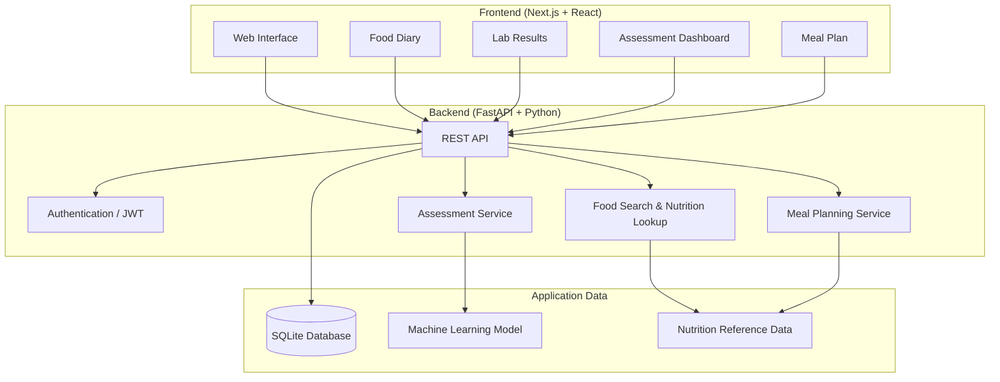

# 🥗 NutriSense — AI-Based Nutritional Assessment & Personalized Meal Planning

<p align="center">
  
  
  
  
  
  
</p>

NutriSense is an AI-based nutritional assessment and personalized meal-planning platform. It combines dietary tracking, optional laboratory biomarker inputs, and machine-learning-based risk estimation to help users understand their nutritional intake and explore personalized food recommendations.

**Live Application:** https://nutri-sense-nu.vercel.app

**Backend API:** https://nutrisense-1-78wm.onrender.com

**API Documentation:** https://nutrisense-1-78wm.onrender.com/docs

---

## 📌 Table of Contents

- [Overview](#-overview)
- [Key Features](#-key-features)
- [System Architecture](#-system-architecture)
- [Machine Learning & Nutritional Assessment](#-machine-learning--nutritional-assessment)
- [Tech Stack](#-tech-stack)
- [Project Directory Structure](#-project-directory-structure)
- [API Documentation](#-api-documentation)
- [Getting Started](#-getting-started)
  - [Prerequisites](#prerequisites)
  - [Backend Setup](#1-backend-setup)
  - [Frontend Setup](#2-frontend-setup)
- [Environment Configuration](#-environment-configuration)
- [Deployment](#-deployment)
- [Database Notes](#-database-notes)
- [Clinical Disclaimer](#-clinical-disclaimer)
- [Author & Acknowledgments](#-author--acknowledgments)

---

## 🌟 Overview

NutriSense brings together several sources of nutritional information:

1. **Dietary Intake Tracking:** Users can record meals and review estimated macro- and micronutrient intake.
2. **Clinical Biomarker Inputs:** Users can enter available laboratory values such as hemoglobin, ferritin, vitamin D, vitamin B12, and calcium.
3. **Machine Learning Assessment:** A Random Forest-based model estimates risk across selected nutrients using the project's configured features and labels.
4. **Personalized Food and Meal Suggestions:** Recommendations take nutritional needs and dietary preferences or restrictions into account.

The platform is intended for nutritional screening, learning, and decision support—not medical diagnosis.

---

## ✨ Key Features

### 🥗 1. Food Diary

- Log food across breakfast, lunch, dinner, and snacks.
- Review estimated calories, protein, carbohydrates, fats, and selected micronutrients.
- Track food intake over multiple days.

### 🧪 2. Lab Results

Users can record available biomarkers, including:

- Hemoglobin
- Ferritin
- Serum 25-hydroxyvitamin D
- Vitamin B12
- Calcium

### 🤖 3. Nutritional Assessment

- Estimate deficiency risk for configured nutrients, including iron, vitamin D, vitamin B12, calcium, folate, vitamin A, vitamin C, magnesium, zinc, and protein.
- Present assessment results and food recommendations based on the implemented assessment logic.

### 📅 4. Personalized Meal Planning

- Generate a 7-day meal plan.
- Account for configured nutritional targets and dietary preferences or restrictions such as vegetarian, vegan, gluten-free, dairy-free, and nut-free.

### 📈 5. Progress Tracking

- Review dietary consistency and nutritional trends over time.

---

## 🏗️ System Architecture



---

## 🧠 Machine Learning & Nutritional Assessment

The project uses a Random Forest-based machine-learning workflow for nutritional risk estimation.

The model and preprocessing artifacts are stored in the backend's model directory (if included in the repository). The exact training dataset, validation metrics, feature definitions, and clinical labeling thresholds should be kept consistent with the model-training code and accompanying metadata.

**Important:** Model predictions are estimates based on the data and rules implemented in this project. They are not clinical diagnoses. Refer to the model metadata and training scripts for the authoritative training details.

---

## 💻 Tech Stack

### Frontend

- **Framework:** Next.js
- **UI Library:** React
- **Styling:** Tailwind CSS and custom CSS
- **HTTP Client:** Axios
- **UI Notifications:** React Hot Toast

### Backend

- **Framework:** FastAPI
- **ASGI Server:** Uvicorn
- **ORM:** SQLAlchemy
- **Database:** SQLite
- **Authentication:** JWT
- **Validation:** Pydantic
- **Machine Learning:** Scikit-learn, NumPy, Pandas, Joblib

### Hosting

- **Frontend:** Vercel
- **Backend:** Render
- **Database:** SQLite file stored with the backend application

---

## 📁 Project Directory Structure

The main project layout is:

```text
NutriSense/
├── backend/
│   ├── main.py
│   ├── database.py
│   ├── models.py
│   ├── schemas.py
│   ├── auth.py
│   ├── jwt_utils.py
│   ├── health_profile.py
│   ├── food_diary.py
│   ├── lab_results.py
│   ├── assessment.py
│   ├── meal_plan.py
│   ├── food_data.py
│   ├── requirements.txt
│   ├── data/
│   │   └── nutrisense.db
│   └── models/
│       ├── deficiency_model.joblib
│       ├── preprocess.joblib
│       └── meta.json
│
├── frontend/
│   ├── app/
│   ├── components/
│   ├── context/
│   ├── utils/
│   │   └── axios.js
│   └── package.json
│
└── README.md
```

This is an indicative structure. Keep the tree aligned with the files and folders actually committed to your repository.

---

## 🔌 API Documentation

When running locally, FastAPI's interactive Swagger documentation is available at:

- **Local:** http://127.0.0.1:8000/docs
- **Production:** https://nutrisense-1-78wm.onrender.com/docs

### Key API Areas

| Category | Example Endpoint | Purpose |
|---|---|---|
| Authentication | `POST /auth/signup` | Register a user |
| Authentication | `POST /auth/login` | Authenticate and obtain a JWT |
| Health Profile | `/health-profile/` | Create or update the user's health profile |
| Food Search | Food search route configured by the backend | Search food records in the SQLite database |
| Food Diary | `/diary/` routes | Record and retrieve food diary entries |
| Lab Results | `/lab-results/` routes | Record laboratory biomarkers |
| Assessment | `/assessment/` routes | Run and retrieve nutritional assessments |
| Meal Plan | `/meal-plan/` routes | Generate and retrieve meal plans |

For exact paths, methods, request bodies, and response schemas, use the live Swagger documentation. The endpoint list above is a high-level guide; route definitions in the backend are authoritative.

---

## 🚀 Getting Started

### Prerequisites

- Python 3.10 or later (use a version supported by the dependencies in `backend/requirements.txt`)
- Node.js (use a version supported by the frontend dependencies)
- Git

### 1. Backend Setup

```bash
# Go to the backend directory
cd backend

# Create a virtual environment
python3 -m venv venv

# Activate it on macOS/Linux
source venv/bin/activate

# On Windows, use:
# venv\Scripts\activate

# Install Python dependencies
pip install -r requirements.txt

# Start the FastAPI development server
uvicorn main:app --reload --host 127.0.0.1 --port 8000
```

The backend will be available at http://127.0.0.1:8000.

Swagger documentation: http://127.0.0.1:8000/docs.

### 2. Frontend Setup

Open a second terminal:

```bash
# Go to the frontend directory
cd frontend

# Install JavaScript dependencies
npm install

# Start the Next.js development server
npm run dev
```

The frontend will be available at http://localhost:3000.

---

## ⚙️ Environment Configuration

Do not commit real secrets to GitHub. Add the following values in the appropriate local or hosting environment settings.

### Frontend

Create `frontend/.env.local` for local development:

```env
NEXT_PUBLIC_API_URL=http://127.0.0.1:8000
```

For the deployed Vercel project, configure:

```env
NEXT_PUBLIC_API_URL=https://nutrisense-1-78wm.onrender.com
```

Because this variable starts with `NEXT_PUBLIC_`, it is exposed to the browser. It should contain the public API base URL only—not passwords, tokens, or private keys.

Redeploy the frontend after changing a Vercel environment variable.

### Backend

Configure a strong, randomly generated `SECRET_KEY` in the backend environment.

For local development, it can be placed in `backend/.env` if the application is configured to load that file. For Render, add it under the backend service's Environment settings.

```env
SECRET_KEY=replace_with_a_long_random_secret
```

Do not use the example value above as a real secret. Do not publish your actual secret in this README or commit it to GitHub.

---

## ☁️ Deployment

NutriSense is deployed with the frontend and backend hosted separately.

### Frontend — Vercel

- **Live URL:** https://nutri-sense-nu.vercel.app
- Set the Vercel environment variable `NEXT_PUBLIC_API_URL` to the deployed Render backend URL.
- Trigger a new deployment after changing frontend environment variables.

### Backend — Render

- **Live URL:** https://nutrisense-1-78wm.onrender.com
- **API Documentation:** https://nutrisense-1-78wm.onrender.com/docs
- Configure `SECRET_KEY` in the Render service's environment variables.
- Ensure the service's build and start commands match the backend's Python setup and application entry point.

---

## 🗄️ Database Notes

NutriSense uses **SQLite** through SQLAlchemy.

The configured database file is:

```text
backend/data/nutrisense.db
```

The backend's `database.py` builds this path relative to its own file location, rather than relying on the process's current working directory.

Food search reads food records from the configured SQLite database. The database must be present at the expected path in the deployed environment and contain the required food records and tables.

**Render Free-plan limitation:** The normal filesystem on a free Render service is ephemeral. SQLite data written at runtime may be lost when the service is restarted or redeployed. A committed database file may be included in a deployment, but that does not make runtime changes durable. Back up the database before deployments or other changes that could replace it. Persistent disks are a separate Render feature and are not available on the free plan.

Do not run database reset or destructive seeding commands against a database containing user data unless you have made and verified a backup.

---

## ⚕️ Clinical Disclaimer

> **Important:** NutriSense is an educational and decision-support prototype for nutritional tracking and screening. It is not a certified medical diagnostic device and must not replace professional medical advice, diagnosis, or treatment. Users should discuss concerning laboratory results, suspected deficiencies, and major dietary changes with a registered dietitian or qualified healthcare professional.

---

## 👤 Author & Acknowledgments

- **Lead Developer:** [Aditya Mishra](https://github.com/adimishra12)
- **Data Acknowledgments:** CDC National Health and Nutrition Examination Survey (NHANES); Indian Council of Medical Research (ICMR) and National Institute of Nutrition (NIN), including the Indian Food Composition Tables (IFCT), where applicable to the project's data pipeline.
