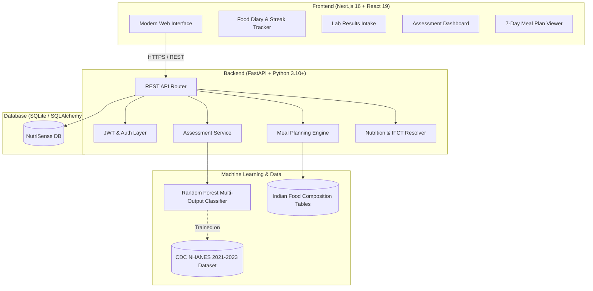

# 🥗 NutriSense — AI-Based Nutritional Assessment & Personalized Meal Planning

<p align="center">
  
  
  
  
  
  
  
</p>

An intelligent, clinically-informed healthcare platform designed to identify micronutrient and macronutrient deficiencies through dietary tracking and lab biomarker evaluation, providing dynamic, 7-day personalized meal plans with regional Indian and global food options.

---

## 📌 Table of Contents

- [Overview](#-overview)
- [Key Features](#-key-features)
- [System Architecture](#-system-architecture)
- [Machine Learning & Clinical Engine](#-machine-learning--clinical-engine)
- [Tech Stack](#-tech-stack)
- [Project Directory Structure](#-project-directory-structure)
- [API Documentation](#-api-documentation)
- [Getting Started](#-getting-started)
  - [Prerequisites](#prerequisites)
  - [Backend Setup](#1-backend-setup)
  - [Frontend Setup](#2-frontend-setup)
  - [Database Seeding](#3-database-seeding)
- [Environment Configuration](#-environment-configuration)
- [Clinical Disclaimer](#-clinical-disclaimer)
- [Author & Acknowledgments](#-author--acknowledgments)

---

## 🌟 Overview

Micronutrient malnutrition ("hidden hunger") affects over two billion people worldwide. Traditional dietary evaluations are often subjective, intermittent, and detached from physiological markers. 

**NutriSense** bridges this gap by unifying:
1. **Continuous Dietary Intake**: Multi-day food logging mapped against calibrated nutritional composition databases (IFCT & USDA).
2. **Clinical Biomarkers**: Blood lab indicators (Hemoglobin, Serum Ferritin, 25-OH Vitamin D, Serum B12, Calcium) to anchor assessments in clinical reality.
3. **Machine Learning Predictive Risk**: A multi-output Random Forest Classifier trained on the CDC's NHANES (National Health and Nutrition Examination Survey) dataset.
4. **Adaptive Dietary Optimization**: Algorithmically formulated 7-day therapeutic meal plans matching specific deficiencies, caloric needs, and dietary preferences (Vegetarian, Vegan, Gluten-Free, Dairy-Free, Nut-Free).

---

## ✨ Key Features

### 🥗 1. Intelligent Food Diary
- Real-time logging across breakfast, lunch, dinner, and snacks.
- Instant nutrient breakdown: Calories, Protein, Carbohydrates, Fats, Iron, Calcium, Vitamin D, Vitamin B12, Folate, Vitamin A, Vitamin C, Magnesium, and Zinc.
- Streak tracker enforcing consecutive logging days for statistically reliable assessment.

### 🧪 2. Clinical Lab Biomarker Integration
- Optional entry of blood panel markers:
  - **Hemoglobin & Ferritin** (Anemia screening)
  - **Serum 25-Hydroxyvitamin D** (Bone & immune health)
  - **Serum Vitamin B12** (Neurological & metabolic health)
  - **Serum Calcium** (Skeletal & muscular function)

### 🤖 3. Machine Learning Deficiency Assessment
- Multi-output classification engine predicting deficiency risks across **10 key nutrients**:
  - `Iron`, `Vitamin D`, `Vitamin B12`, `Calcium`, `Folate`, `Vitamin A`, `Vitamin C`, `Magnesium`, `Zinc`, `Protein`
- Severity scoring and actionable clinical insights with evidence-backed nutrient food suggestions.

### 📅 4. 7-Day Personalized Meal Planner
- Customizes weekly dietary schedules addressing the user's specific deficiency profile.
- Strict adherence to caloric targets, macro distributions, and dietary constraints (Vegetarian, Vegan, Gluten-Free, Dairy-Free, Nut-Free).
- Built-in regional food alias mapper resolving traditional Indian food names (e.g., *Palak*, *Rajma*, *Ragi*, *Moringa Leaves*, *Bajra*, *Chana*).

### 📈 5. Longitudinal Progress Tracking
- Visual dashboard monitoring weekly caloric consistency, nutrient density improvements, and risk mitigation over time.

---

## 🏗️ System Architecture



---

## 🧠 Machine Learning & Clinical Engine

### Training Dataset & Metrics
- **Source**: CDC NHANES (National Health and Nutrition Examination Survey) 2021–2023 cycle.
- **Dataset Partition**: 2,732 training records, 684 holdout validation records.
- **Model Architecture**: Multi-Output Random Forest with scikit-learn standard preprocessing pipeline (`SimpleImputer` + `StandardScaler`).

### Feature Vector (Input)
| Feature | Unit | Description |
|---|---|---|
| `gender` | Binary (0: Male, 1: Female) | Biological gender |
| `age_years` | Years | Chronological age |
| `calories_kcal` | kcal | Daily average energy intake |
| `protein_g` | g | Daily average protein consumption |
| `iron_mg` | mg | Daily average iron intake |
| `calcium_mg` | mg | Daily average calcium intake |
| `vitamin_d_mcg` | mcg | Daily average cholecalciferol intake |
| `vitamin_b12_mcg`| mcg | Daily average cobalamin intake |
| `folate_mcg` | mcg | Daily average dietary folate equivalents |
| `vitamin_a_mcg` | mcg | Daily average retinol activity equivalents |
| `vitamin_c_mg` | mg | Daily average ascorbic acid intake |
| `magnesium_mg` | mg | Daily average magnesium intake |
| `zinc_mg` | mg | Daily average elemental zinc intake |

### Clinical Ground Truth Labeling Rules
- **Iron Deficiency**: Lab Hb (<13.0 g/dL M / <12.0 g/dL F) OR Ferritin < 30 ng/mL; alternatively, dietary intake < 8 mg/day.
- **Vitamin D Deficiency**: Serum 25(OH)D < 50 nmol/L; alternatively, dietary intake < 15 mcg/day.
- **Vitamin B12 Deficiency**: Dietary intake < 2.4 mcg/day.
- **Calcium Deficiency**: Dietary intake < 1000 mg/day.
- **Folate Deficiency**: Dietary intake < 400 mcg/day.
- **Vitamin A Deficiency**: Dietary intake < 700 mcg/day.
- **Vitamin C Deficiency**: Dietary intake < 75 mg/day.
- **Magnesium Deficiency**: Dietary intake < 320 mg/day.
- **Zinc Deficiency**: Dietary intake < 8 mg/day.
- **Protein Deficiency**: Dietary intake < 50 g/day.

---

## 💻 Tech Stack

### Frontend
- **Framework**: [Next.js 16](https://nextjs.org/) (App Router, Turbopack)
- **Library**: [React 19](https://react.dev/)
- **Styling**: Tailwind CSS & Modern Custom CSS Modules
- **Icons & UI**: React Icons (`react-icons`), React Hot Toast (`react-hot-toast`), Poppins Typography
- **Networking**: Axios with centralized HTTP interceptors

### Backend
- **Framework**: [FastAPI](https://fastapi.tiangolo.com/) (Asynchronous Python Web Framework)
- **ASGI Server**: Uvicorn
- **ORM & Database**: SQLAlchemy with SQLite
- **Security**: JWT (Python-JOSE), Passlib (bcrypt password hashing)
- **Data Validation**: Pydantic v2 schemas
- **Machine Learning**: Scikit-learn, Joblib, NumPy, Pandas

---

## 📁 Project Directory Structure

```text
├── backend/
│   ├── main.py                     # FastAPI application entrypoint & middleware
│   ├── database.py                 # SQLAlchemy engine & session initialization
│   ├── models.py                   # Relational ORM models (Users, Diaries, Assessments)
│   ├── schemas.py                  # Pydantic input/output schemas
│   ├── auth.py                     # JWT registration & login endpoints
│   ├── jwt_utils.py                # Token generation, decoding, & user dependencies
│   ├── health_profile.py           # User physical parameters & dietary restrictions
│   ├── food_diary.py               # Food diary ingestion, logging & streak engine
│   ├── lab_results.py              # Clinical biomarker lab results endpoints
│   ├── assessment.py               # ML-driven deficiency risk prediction engine
│   ├── meal_plan.py                # 7-day personalized therapeutic meal plan planner
│   ├── food_data.py                # Food item queries & nutritional lookup
│   ├── seed.py                     # Database seeder for IFCT & USDA food items
│   ├── requirements.txt            # Python dependencies
│   └── models/
│       ├── deficiency_model.joblib # Serialized Random Forest model
│       ├── preprocess.joblib       # Preprocessing scaler & imputer pipeline
│       └── meta.json               # Model training metadata & thresholds
│
├── frontend/
│   ├── app/
│   │   ├── page.js                 # Modern responsive landing page
│   │   ├── layout.js               # Root layout, fonts & context providers
│   │   ├── globals.css             # Global styling & Tailwind utilities
│   │   ├── login/                  # Authentication sign-in page
│   │   ├── signup/                 # New user registration page
│   │   ├── onboarding/             # Health profile intake workflow
│   │   ├── dashboard/              # Central metrics & activity overview
│   │   ├── diary/                  # Daily nutritional food logging interface
│   │   ├── lab-results/            # Clinical blood markers entry
│   │   ├── assessment/             # Deficiency risk analysis & breakdown
│   │   ├── meal-plan/              # 7-day dynamic meal plan viewer
│   │   └── progress/               # Historical streak & health trajectory
│   ├── components/                 # Reusable UI widgets, inputs & sidebars
│   ├── context/                    # AuthContext & user state management
│   └── package.json                # Frontend package dependencies & scripts
│
├── README.md                       # Comprehensive project documentation
└── AGENTS.md                       # Environment, compiler, & agent runtime guide
```

---

## 🔌 API Documentation

When the backend is running, interactive Swagger/OpenAPI documentation is available at `http://127.0.0.1:8000/docs`.

### Key Endpoints

| Category | Method | Endpoint | Description |
|---|---|---|---|
| **Auth** | `POST` | `/auth/register` | Register a new user |
| **Auth** | `POST` | `/auth/login` | Authenticate and obtain JWT token |
| **Profile** | `GET` | `/health-profile/me` | Fetch active user health profile |
| **Profile** | `POST` | `/health-profile/` | Create or update physical profile |
| **Diary** | `GET` | `/diary/today` | Fetch today's logged meals & totals |
| **Diary** | `POST` | `/diary/entry` | Log a food item with portion size |
| **Diary** | `GET` | `/diary/streak` | Check current consecutive logging streak |
| **Labs** | `POST` | `/lab-results/` | Record blood biomarkers |
| **Assessment** | `POST` | `/assessment/run` | Execute ML deficiency risk model |
| **Assessment** | `GET` | `/assessment/latest` | Retrieve most recent assessment |
| **Assessment** | `GET` | `/assessment/recommendations` | Get top foods to treat a nutrient deficiency |
| **Meal Plan** | `POST` | `/meal-plan/generate` | Construct dynamic 7-day meal plan |
| **Meal Plan** | `GET` | `/meal-plan/latest` | Fetch active 7-day meal plan |

---

## 🚀 Getting Started

### Prerequisites
- **Node.js**: `v22 LTS` (`/opt/homebrew/opt/node@22/bin`)
- **Python**: `3.10+`
- **Git**

---

### 1. Backend Setup

```bash
# Navigate to backend directory
cd backend

# Create and activate Python virtual environment
python3 -m venv venv
source venv/bin/activate       # On Windows: venv\Scripts\activate

# Install dependencies
pip install -r requirements.txt

# Start FastAPI development server
uvicorn main:app --reload --port 8000
```
The API will be available at `http://127.0.0.1:8000` (Docs at `http://127.0.0.1:8000/docs`).

---

### 2. Frontend Setup

```bash
# Navigate to frontend directory
cd frontend

# Install Node dependencies
npm install

# Start Next.js development server
npm run dev
```
The application will be running at `http://localhost:3000`.

---

### 3. Database Seeding

To populate the database with food composition tables and initial health references:

```bash
cd backend
source venv/bin/activate
python seed.py
```

---

## ⚙️ Environment Configuration

### Frontend (`frontend/.env.local` optional)
```env
NEXT_PUBLIC_API_URL=http://127.0.0.1:8000
```

### Backend (`backend/.env` optional)
```env
SECRET_KEY=your_super_secret_jwt_key_here
ALGORITHM=HS256
ACCESS_TOKEN_EXPIRE_MINUTES=1440
```

---

## ⚕️ Clinical Disclaimer

> **IMPORTANT**: NutriSense is an educational and decision-support prototype developed for computational research and nutritional screening. It is **not** a certified medical diagnostic device. Dietary adjustments, especially those relating to severe clinical deficiencies or chronic illness, should always be verified with a registered dietitian or licensed medical professional.

---

## 👤 Author & Acknowledgments

- **Lead Developer**: [Aditya Mishra](https://github.com/adimishra12)
- **Data Acknowledgments**:
  - CDC National Health and Nutrition Examination Survey (NHANES)
  - Indian Council of Medical Research (ICMR) & National Institute of Nutrition (NIN) — Indian Food Composition Tables (IFCT)
